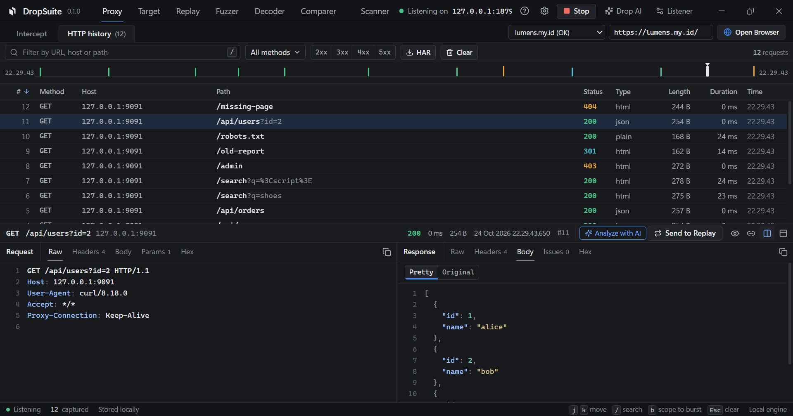
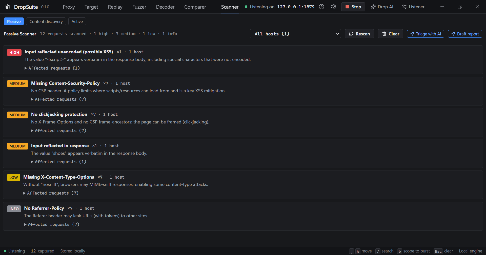
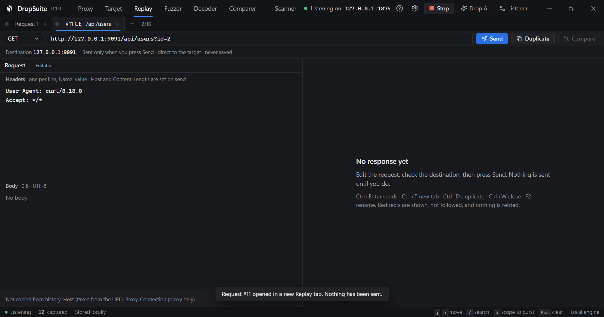
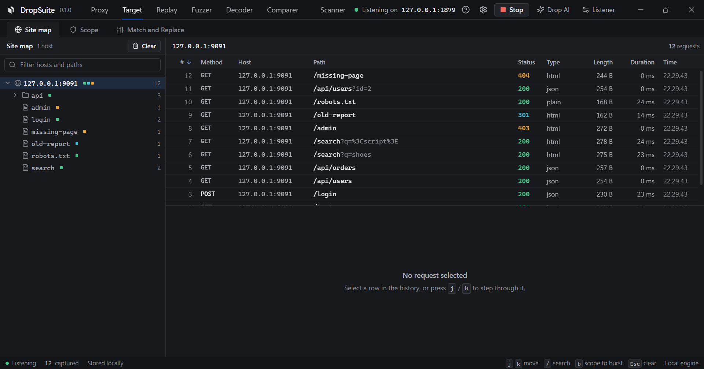
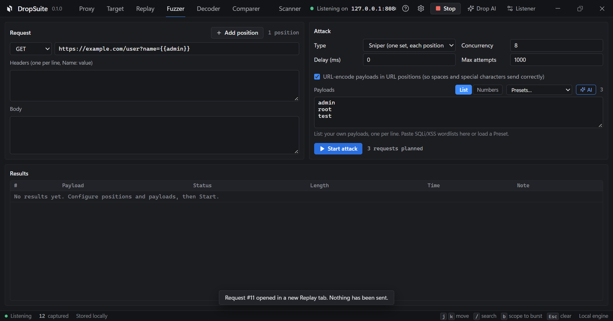

<div align="center">

<picture>
  <source media="(prefers-color-scheme: dark)" srcset="docs/assets/dropsuite-mark-dark.svg" />
  
</picture>

# DropSuite

A local-first, intercepting web security testing proxy. Free, with no paywalled core.

[](LICENSE)


</div>

DropSuite sits between your browser and a target, then captures, inspects, replays and fuzzes the
HTTP traffic that passes through. It is built for one person testing one target on their own
machine. Everything it captures stays in a local SQLite file, and the app makes no analytics or
pingback calls of its own.

It is written in Rust (Tokio) with a Tauri 2 desktop shell and a React UI. The engine has no GUI
dependency, so it also runs headless.

> **Authorized use only.** Test systems you own or have written permission to test, or deliberately
> vulnerable practice targets such as OWASP Juice Shop. You are responsible for how you use it.

<div align="center">
  
  <br /><sub>HTTP history with the request and response inspector</sub>
</div>

## Contents

- [What it does](#what-it-does)
- [Install](#install)
- [Getting started](#getting-started)
- [Build from source](#build-from-source)
- [Status](#status)
- [Layout](#layout)
- [Community](#community)

## What it does

| Capability | What it does |
| --- | --- |
| **Proxy and HTTPS interception** | An HTTP/1.1 forward proxy on `127.0.0.1:8080`. HTTPS is decrypted only for hosts you allowlist; everything else is tunnelled untouched. The root CA key is stored encrypted at rest (Windows DPAPI, or owner only file permissions on macOS and Linux) and is never installed into any trust store. |
| **HTTP history and inspector** | Every request and response, searchable and filterable, with headers, body and timing. Credentials are redacted before they are written to disk; reveal the real value in the app when you need it, held in memory for the session only and never saved. |
| **Intercept** | Hold a request or response, edit it, then forward or drop it. |
| **Target tools** | A site map built from captured traffic, scope rules, and match and replace applied to requests and responses in flight. |
| **Replay** | Edit one request and resend it. Each tab keeps its own attempt history, and you can compare two responses side by side. |
| **Fuzzer** | Mark positions and run Sniper or Cluster bomb with your own payload lists or a loaded wordlist. Out of scope and restricted targets are refused, not sent. |
| **Decoder and Comparer** | Encode and decode Base64, URL, Hex, HTML and JWT, all locally. Diff two texts line by line. |
| **Scanner** | Passive checks across the captured history, grouped by type and severity, plus content discovery against a target. An active scanner is in progress (see Status). |
| **Drop AI** | Bring your own model and key. Secrets are redacted and the exact prompt is previewed before anything is sent, and requests go straight to your endpoint, never through the proxy. The key is stored at rest the same way as the CA key (Windows DPAPI, or owner only file permissions on macOS and Linux) and never reaches the frontend, the logs or version control. |
| **Settings** | A dark and a light theme, optional update checks against GitHub, and one click to the local log and data folders, all in one panel. |

<table>
  <tr>
    <td width="50%" align="center">
      
      <br /><sub><b>Scanner</b>: passive findings by type and severity</sub>
    </td>
    <td width="50%" align="center">
      
      <br /><sub><b>Replay</b>: edit a request, resend, compare responses</sub>
    </td>
  </tr>
  <tr>
    <td width="50%" align="center">
      
      <br /><sub><b>Target</b>: site map, scope, match and replace</sub>
    </td>
    <td width="50%" align="center">
      
      <br /><sub><b>Fuzzer</b>: mark positions, Sniper or Cluster bomb</sub>
    </td>
  </tr>
</table>

## Install

Grab the file for your system from the [latest release](https://github.com/fraxzu/dropsuite/releases/latest),
then check it against the `SHA256SUMS` published next to it. The builds are 64 bit (Apple silicon on
macOS).

**Windows 10 and 11.** Download `DropSuite_0.1.0_x64-setup.exe` and run it. The installer is per user
and needs no admin rights. It is not code signed yet, so SmartScreen warns on first run: choose
**More info**, then **Run anyway**.

**macOS (Apple silicon).** Download `DropSuite_0.1.0_aarch64.dmg`, open it, and drag DropSuite to
Applications. The app is not notarized yet, so the first time you launch it, right click the app and
choose **Open** to get past Gatekeeper.

**Debian, Ubuntu and derivatives.** Download `DropSuite_0.1.0_amd64.deb` and install it with
`sudo apt install ./DropSuite_0.1.0_amd64.deb`.

**Fedora, openSUSE and derivatives.** Download `DropSuite-0.1.0-1.x86_64.rpm` and install it with
`sudo dnf install ./DropSuite-0.1.0-1.x86_64.rpm`.

**Any Linux, one file.** Download `DropSuite_0.1.0_amd64.AppImage`, make it executable with
`chmod +x DropSuite_0.1.0_amd64.AppImage`, and run it. No install needed.

## Getting started

1. Press **Start** in the top bar to run the proxy listener on `127.0.0.1:8080`.
2. For HTTPS, open **Listener** settings to generate the local root CA, then add the hosts you want
   decrypted to the allowlist. Trust the CA only while you test; plain HTTP needs no CA.
3. Send traffic through the proxy: click **Open Browser** in the Proxy tab for an isolated browser
   already wired to the listener, or point your own browser or system proxy at `127.0.0.1:8080`.
   Then browse your target.
4. Watch requests land in **HTTP history**. From there, send one to **Replay**, mark positions for
   the **Fuzzer**, or open **Scanner** to check what you have captured.

Only allowlisted HTTPS hosts are decrypted; everything else is tunnelled untouched.

## Build from source

Requires Rust (stable) and Node.js. From the repository root:

```sh
# Frontend (needed before any Tauri build)
cd frontend && npm install && npm run build && cd ..

# Run the tests
cargo test --workspace

# Build the desktop app and installer
node frontend/node_modules/@tauri-apps/cli/tauri.js build
```

## Status

DropSuite is alpha. These are shipped and covered by the test suite:

- Proxy, HTTPS interception, intercept, HTTP history with redaction
- Site map, scope, match and replace
- Replay with per tab history and response diffing
- Fuzzer (Sniper and Cluster bomb), custom wordlists
- Decoder, Comparer
- Passive scanner and content discovery
- Cookie jar and interactive challenge handling
- Drop AI (bring your own key)

In progress: an active scanner with evidence and confidence scoring, and out of band detection.
Interfaces and data formats can still change.

## Layout

- `crates/dropsuite-core`: the engine (proxy, HTTPS interception, CA, replay, intruder, scope,
  cookies, challenge detection, storage). No GUI dependency.
- `crates/dropsuite-app`: the Tauri desktop app (IPC commands, engine setup).
- `crates/dropsuite-desktop`: a headless dev daemon with an HTTP bridge.
- `crates/dropsuite-cli`: a verification suite with a local mock upstream.
- `frontend/`: the React and Vite UI.
- `docs/`: architecture notes and the screenshots used in this README.

## Community

- [License: MIT](LICENSE)
- [Contributing](CONTRIBUTING.md)
- [Security policy](SECURITY.md)
