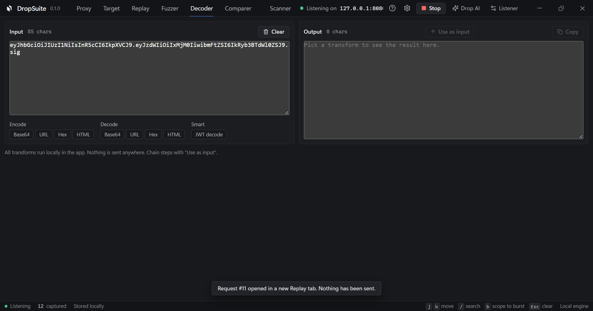
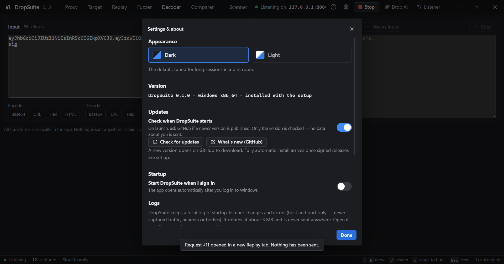

<div align="center">

<picture>
  <source media="(prefers-color-scheme: dark)" srcset="docs/assets/dropsuite-mark-dark.svg" />
  
</picture>

# DropSuite

### A local-first, intercepting web security testing proxy.<br />Free, open source, with no paywalled core.

[](https://github.com/fraxzu/dropsuite/releases/latest)
[](LICENSE)
[](#)
[](#supported-packages)
[](https://www.rust-lang.org/)

<br />

<a href="https://github.com/fraxzu/dropsuite/releases/latest">
  
</a>

<br /><br />

[**Downloads**](#install) | [**Highlights**](#key-highlights) | [**What It Does**](#what-it-does) | [**Showcase**](#visual-showcase) | [**Quick Start**](#getting-started) | [**Root CA Setup**](#trusting-the-root-ca) | [**Build from Source**](#build-from-source)

</div>

---

DropSuite sits between your browser and target servers to capture, inspect, modify, replay, and fuzz HTTP/HTTPS traffic. Built specifically for security researchers, penetration testers, and bug bounty hunters who demand uncompromised performance and privacy on their local machines.

Everything captured stays inside your local SQLite database (`history.db`). The application transmits zero telemetry, performs zero analytics, and makes zero background pingbacks.

> **Authorized testing only.** Only test applications and infrastructure you own or have explicit written authorization to assess (or deliberately vulnerable labs such as OWASP Juice Shop and PortSwigger Web Security Academy). You are solely responsible for all testing conducted with DropSuite.

<br />

<div align="center">
  
  <br /><sub><b>HTTP History & Stream Inspector</b>: real-time streaming traffic, timeline metrics, and split request/response inspector</sub>
</div>

<br />

---

## Key Highlights

- **Zero Telemetry & 100% Local-First**: All request history, cookies, and tokens stay in local SQLite storage (`history.db`). Redaction filters automatically strip credentials at the persistence boundary while allowing on-demand, in-memory inspection.
- **No Paywalled Workflows**: Unthrottled fuzzing (Sniper, Cluster Bomb), multi-tab Repeater with response diffing, and native Active Vulnerability Scanning are free under the MIT License.
- **High-Performance Rust Core**: Powered by Tokio async I/O with HTTP/1.1 and upstream HTTP/2 multiplexing, handling high concurrency and large traffic volumes without UI lag.
- **Embedded Browser & Bot Challenge Solver**: Built-in isolated browser (`WebView2` on Windows, `WebKitGTK` on Linux) pre-routed to the proxy with automatic cookie harvesting (`cf_clearance`, Akamai tokens) and User-Agent pinning into the session Cookie Jar.
- **Drop AI (Bring Your Own Key)**: Contextual AI security assistant (OpenAI and Anthropic compatible) with streaming responses. Prompts are previewed before sending, and API keys are encrypted at rest using Windows DPAPI or 0600 file permissions.

---

## What It Does

| Capability | Technical Specification |
|---|---|
| **Proxy & HTTPS Interception** | Forward proxy on `127.0.0.1:8080` with HTTP/1.1 and HTTP/2 upstream negotiation. Decrypts only allowlisted HTTPS hosts using dynamic leaf certificates (`rcgen`/`rustls`); all non-allowlisted traffic tunnels untouched via raw TCP. Root CA key is encrypted at rest (Windows DPAPI, Linux/macOS 0600) and never touches OS trust stores automatically. |
| **Embedded Browser & Challenge Solver** | Built-in isolated browser (`WebView2` on Windows, `WebKitGTK` on Linux) configured to trust only DropSuite-minted certificates for allowlisted hosts. Solves Cloudflare/Akamai bot challenges and automatically syncs harvested cookies and User-Agent into the session Cookie Jar. |
| **HTTP History & Inspector** | Continuous capture stream with real-time substring filtering, regex search, HTTP method filters, and status code filters. Transparent on-the-fly decompression for `gzip`, `deflate`, and `br` (Brotli). Credentials and tokens are redacted at the database boundary, with single-click reveal in memory. |
| **Interactive Intercept** | Pause in-flight HTTP requests or responses, edit wire bytes, forward or drop individually or in batch, with full queue capacity and backpressure safety. |
| **Target & Scope Control** | Hierarchical site map generated dynamically from traffic, regex and prefix scope enforcement, and in-flight request/response match-and-replace rules. |
| **Replay (Repeater)** | Multi-tab request editor with persistent attempt history, side-by-side response diffing, browser header presets (Chrome, Edge, Firefox, Safari), and Cookie Jar integration. Refuses outbound SMTP (port 25) for safety parity. |
| **Fuzzer (Intruder)** | Parameterized attacks supporting Sniper, Battering Ram, Pitchfork, and Cluster Bomb modes. Load custom wordlists (SecLists compatible, up to 20,000 paths) or use built-in presets with concurrency and delay pacing. |
| **Active & Passive Scanner** | Passive security header and cookie audits on captured HTML documents. Native active vulnerability scanner covering Reflected XSS (context-aware), SQLi (boolean differential, error-based with database fingerprinting, and time-based), Path Traversal, Open Redirect (with XSS chain detection), CORS misconfigurations, and CRLF injection, with WAF challenge detection and backoff throttling. |
| **Drop AI** | Contextual security audit assistant. Bring your own model and key (OpenAI-compatible or Anthropic endpoints) with streaming SSE. Prompts preview before sending; API keys are encrypted at rest via DPAPI/0600 and never written to repository files or logs. Configurable `reasoning_effort` for reasoning models. |
| **Decoder & Comparer** | Offline encoding and decoding for Base64, URL, Hex, HTML entities, and JWT token inspection. Visual line-by-line text and payload diffing. |
| **Settings & Diagnostics** | Listener configuration, Root CA export, local database management, update checker, and diagnostic log rotation. |

---

## Visual Showcase

<table>
  <tr>
    <td width="50%" align="center">
      <a href="docs/assets/shots/scanner.png">
        
      </a>
      <br /><sub><b>Active & Passive Scanner</b>: context-aware XSS, SQLi (boolean/error/time), traversal, and WAF backoff</sub>
    </td>
    <td width="50%" align="center">
      <a href="docs/assets/shots/replay.png">
        
      </a>
      <br /><sub><b>Replay (Repeater)</b>: multi-attempt request editor, browser header presets, and side-by-side response diffing</sub>
    </td>
  </tr>
  <tr>
    <td width="50%" align="center">
      <a href="docs/assets/shots/target-sitemap.png">
        
      </a>
      <br /><sub><b>Target & Scope</b>: host tree, path hierarchy, scope boundaries, and in-flight match-and-replace rules</sub>
    </td>
    <td width="50%" align="center">
      <a href="docs/assets/shots/fuzzer.png">
        
      </a>
      <br /><sub><b>Fuzzer (Intruder)</b>: payload position markers, attack modes (Sniper, Cluster Bomb), and custom SecLists wordlists</sub>
    </td>
  </tr>
  <tr>
    <td width="50%" align="center">
      <a href="docs/assets/shots/decoder.png">
        
      </a>
      <br /><sub><b>Decoder & Comparer</b>: offline JWT claims analyzer, Base64/Hex/URL transforms, and visual text diffing</sub>
    </td>
    <td width="50%" align="center">
      <a href="docs/assets/shots/settings.png">
        
      </a>
      <br /><sub><b>Settings & CA Management</b>: custom listener ports, Root CA generation/export, logs, and update checker</sub>
    </td>
  </tr>
</table>

---

## Install

Download the installer or pre-compiled binary for your operating system from the
[**latest GitHub Release**](https://github.com/fraxzu/dropsuite/releases/latest).

### Supported Packages

| Platform | Format | Package Name | Installation Guide |
|---|---|---|---|
| **Windows 10 / 11** (64-bit) | **Installer (.exe)** | [`DropSuite_0.1.0_x64-setup.exe`](https://github.com/fraxzu/dropsuite/releases/latest) | Run installer (per-user installation, no admin privileges required).<br />*Unsigned alpha: select **More info** → **Run anyway**.* |
| **Windows 10 / 11** (64-bit) | **Portable (.exe)** | [`DropSuite-portable.exe`](https://github.com/fraxzu/dropsuite/releases/latest) | Standalone single executable. No installation required. |
| **Linux (Universal)** | **AppImage** | [`DropSuite_0.1.0_amd64.AppImage`](https://github.com/fraxzu/dropsuite/releases/latest) | `chmod +x DropSuite_0.1.0_amd64.AppImage && ./DropSuite_0.1.0_amd64.AppImage` |
| **Debian / Ubuntu / Kali** | **.deb** | [`DropSuite_0.1.0_amd64.deb`](https://github.com/fraxzu/dropsuite/releases/latest) | `sudo apt install ./DropSuite_0.1.0_amd64.deb` |
| **Arch Linux / Manjaro** | **PKGBUILD** | `dropsuite-bin` | `cd packaging/arch && makepkg -si` *(see [Arch Packaging Guide](packaging/arch/README.md))* |
| **Fedora / RHEL / openSUSE** | **.rpm** | [`DropSuite-0.1.0-1.x86_64.rpm`](https://github.com/fraxzu/dropsuite/releases/latest) | `sudo dnf install ./DropSuite-0.1.0-1.x86_64.rpm` |
| **macOS (Apple Silicon)** | **.dmg** | [`DropSuite_0.1.0_aarch64.dmg`](https://github.com/fraxzu/dropsuite/releases/latest) | Open DMG, drag to Applications.<br />*Unnotarized alpha: right-click app → choose **Open**.* |

<details>
<summary><b>Verify Checksums (Optional)</b></summary>

<br />

You can optionally verify the integrity of downloaded files against the published `SHA256SUMS` file:

```sh
# Linux / macOS
sha256sum -c SHA256SUMS

# Windows (PowerShell)
Get-FileHash DropSuite_0.1.0_x64-setup.exe -Algorithm SHA256
```

</details>

---

## Getting Started

1. **Start the Proxy Listener**: Click **Start** in the top navigation bar to bind the listener to `127.0.0.1:8080`.
2. **Configure HTTPS Interception**: Open **Listener Settings**, click **Generate Root CA**, then add your target domain(s) to the allowlist. Plain HTTP does not require a CA.
3. **Route Browser Traffic**:
   - **Built-in & Isolated (Recommended)**: Click **Open Browser** in the top bar to launch the embedded browser, which is already configured for proxying and automatically solves bot challenges.
   - **External Browser**: Configure your browser or system proxy to `127.0.0.1:8080` and install the exported `root-ca.pem`.
4. **Analyze & Attack**: Captured requests stream live into **HTTP History**. Send any request to **Replay** (`Ctrl+R`), mark payload injection positions in **Fuzzer**, or trigger the **Scanner**.

---

## Trusting the Root CA

Export `root-ca.pem` from **Listener Settings**, then trust it on your operating system or browser:

```sh
# Windows (PowerShell)
certutil -user -addstore Root root-ca.pem

# macOS (Keychain)
sudo security add-trusted-cert -d -r trustRoot -k /Library/Keychains/System.keychain root-ca.pem

# Arch Linux, Fedora, RHEL
sudo trust anchor --store root-ca.pem

# Debian, Ubuntu, Kali Linux
sudo cp root-ca.pem /usr/local/share/ca-certificates/dropsuite.crt && sudo update-ca-certificates

# Chrome / Chromium on Linux (NSSdb)
certutil -d sql:$HOME/.pki/nssdb -A -t "C,," -n DropSuite -i root-ca.pem
```

**Firefox (All Platforms)**: Settings → Privacy & Security → Certificates → View Certificates → Authorities → Import → Select `root-ca.pem` → Check *Trust this CA to identify websites*.

---

## Build from Source

DropSuite requires Rust (1.80+ stable) and Node.js (v18+ LTS).

```sh
# 1. Build frontend production assets
cd frontend
npm install
npm run build
cd ..

# 2. Run the test suite (Rust core, app, and CLI tests)
cargo test --workspace

# 3. Build native desktop binary and platform packages
node frontend/node_modules/@tauri-apps/cli/tauri.js build
```

---

## Architecture & Layout

DropSuite is engineered as a clean-room modular workspace with zero proprietary bytecode or assets:

```
dropsuite/
├── crates/
│   ├── dropsuite-core/      # Protocol engine: HTTP/1.1 & HTTP/2 proxy, HTTPS MITM, CA,
│   │                        # replay, intruder, active/passive scanner, cookies, storage
│   ├── dropsuite-app/       # Tauri v2 desktop runtime, IPC commands, and platform adapters
│   ├── dropsuite-desktop/   # Headless dev daemon with local HTTP bridge for browser UI
│   └── dropsuite-cli/       # Verification test suite with local mock upstream servers
├── frontend/                # React 18, TypeScript, Vite UI workspace
├── packaging/
│   └── arch/                # Arch Linux PKGBUILD and packaging documentation
└── docs/                    # Architecture blueprints and visual assets
```

---

## Security & Community

- [License: MIT](LICENSE)
- [Security Policy](SECURITY.md)
- [Contributing Guidelines](CONTRIBUTING.md)
- [Issue Tracker & Discussions](https://github.com/fraxzu/dropsuite/issues)
