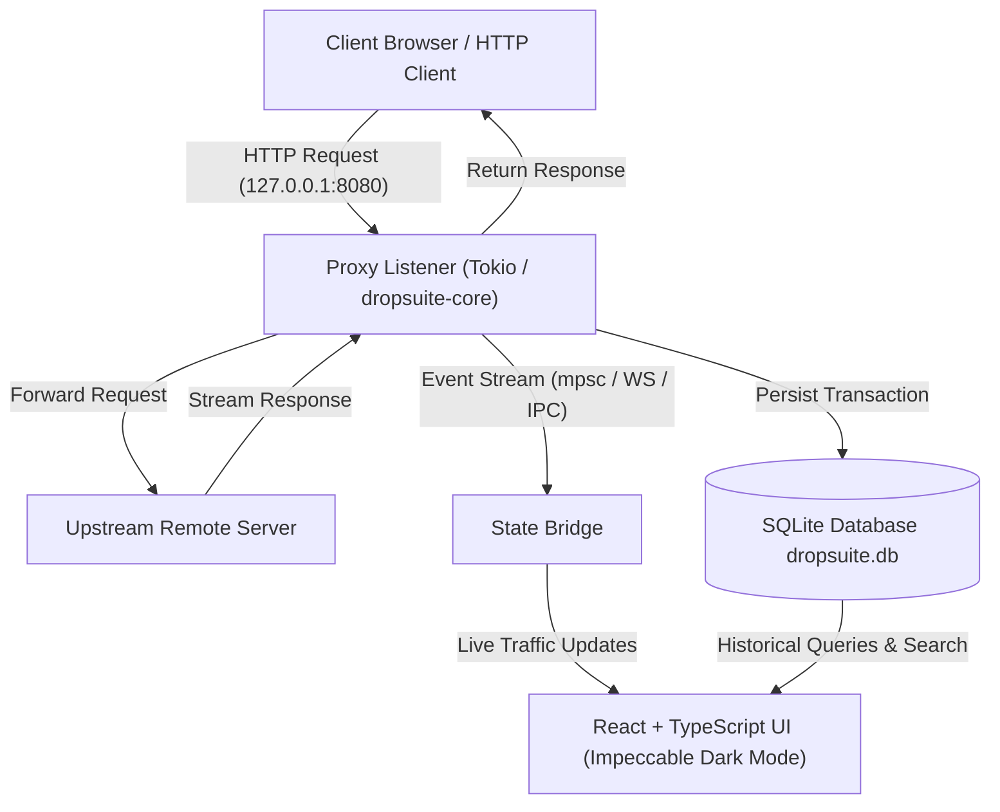

# DropSuite Architecture Specification

**Product:** DropSuite: Free & Open-Source Security Platform  
**Architecture Phase:** P1 (Proxy & History MVP)  
**Selected Stack:** Rust (Tokio, Rusqlite) + React (TypeScript, Vite, Impeccable Style)

---

## 1. Architectural Philosophy

DropSuite is engineered as a **modular, local-first desktop application**.
Its core design principles are:

1. **Strict Decoupling of Engine and Interface:**  
   The Proxy Engine and Storage layer are implemented in a standalone Rust crate (`dropsuite-core`) that has **zero dependency on GUI or Tauri libraries**. It can run headless, be embedded in CLI harnesses, or be driven by automated test suites.
2. **Zero-Overhead Asynchronous I/O:**  
   Network I/O utilizes **Tokio** and non-blocking TCP sockets. Each proxied request is handled in a lightweight Tokio green task without blocking thread pools.
3. **Local-First & Resilient Persistence:**  
   Captured transactions are stored in an embedded SQLite database using `rusqlite` with the `bundled` feature (eliminating any external C DLL dependencies). All data remains on the user's disk; no telemetry or remote calls occur.
4. **Impeccable Interface Design:**  
   The UI follows the **Impeccable Style** design system: high-density information layout, sleek dark mode, JetBrains Mono typography for payloads, and virtualized rendering capable of handling tens of thousands of history items without UI freeze.

---

## 2. System Topology



---

## 3. Modular Crates & File Organization

The project is structured as a unified Cargo Workspace:

```
dropsuite/
├── Cargo.toml                      # Cargo Workspace configuration
├── crates/
│   ├── dropsuite-core/             # Independent Core Engine
│   │   ├── Cargo.toml
│   │   └── src/
│   │       ├── proxy/              # Tokio HTTP Proxy Listener & Forwarder
│   │       ├── storage/            # Embedded SQLite transaction repository
│   │       ├── models/             # Canonical Transaction & Filter models
│   │       └── lib.rs              # Public Engine API
│   ├── dropsuite-cli/              # Headless CLI & Test Harness
│   │   ├── Cargo.toml
│   │   └── src/main.rs             # CLI commands (run, benchmark, test)
│   └── dropsuite-desktop/          # Desktop Application Shell
│       ├── Cargo.toml
│       └── src/main.rs             # Tauri / Desktop bridge launching core & UI
├── frontend/                       # React Dashboard (Vite + TypeScript)
│   ├── src/
│   │   ├── components/             # HistoryTable, DetailInspector, Sidebar, Stats
│   │   ├── styles/                 # Impeccable dark theme tokens
│   │   ├── types/                  # TypeScript interface contracts
│   │   └── App.tsx
│   ├── package.json
│   └── vite.config.ts
└── docs/
    ├── P0_REA_FINDINGS.md
    ├── ARCHITECTURE.md
    ├── ROADMAP.md
    └── P1_TEST_REPORT.md
```

---

## 4. Component Details

### A. `dropsuite-core` (Proxy & Storage)
* **`ProxyEngine`:**
  * Manages listener lifecycle: `start(bind_addr: &str)`, `stop()`.
  * Defaults strictly to loopback: `127.0.0.1:8080`.
  * Intercepts standard HTTP/1.1 requests (`GET`, `POST`, `PUT`, `DELETE`, `HEAD`, `OPTIONS`, `PATCH`).
  * Forwards complete HTTP/1.1 messages (`http1.rs`, RFC 9112 §6). Bodies are delimited by Content-Length, chunked transfer coding or, for responses only, connection close. HEAD, 1xx, 204 and 304 responses never have a body. Bytes are copied unchanged through a 64 KB buffer with write backpressure, so memory per connection stays bounded whatever the body size. The request body streams upstream while the response is read, so `100 Continue` passes through. `101 Switching Protocols` turns the connection into a raw relay.
  * Client connections persist, and pipelined requests keep their boundaries. Each request opens its own upstream connection.
  * Ambiguous framing is rejected, never guessed. Requests get `400`: Content-Length together with Transfer-Encoding, conflicting or invalid Content-Length, a Transfer-Encoding that does not end in `chunked`, bad chunk syntax, bare-LF heads, obsolete line folding, or a missing or repeated Host. Heads over 64 KB get `431`, and `CONNECT` or `https://` targets get `501`. Responses with such framing get `502`. A transfer making no progress for 60 s is abandoned.
  * Forward-proxy semantics (P1.9, RFC 9110 §7.6, RFC 9112 §3.2). These are the only changes the proxy makes to a message; body bytes and framing fields are never changed:
    * An absolute-form target (`GET http://host/path`) is sent to the origin in origin form (`GET /path`). The path is `/` when empty and `*` for an empty `OPTIONS` target, and the fragment is removed. Host is set from the URL's authority, replacing any Host the client sent, with userinfo removed.
    * Hop-by-hop and proxy-only fields are removed in both directions: `Connection`, `Proxy-Connection`, `Keep-Alive`, `TE`, `Upgrade`, `Proxy-Authorization`, `Proxy-Authenticate`, and every field named in `Connection`. A `Connection` option can never remove `Content-Length`, `Transfer-Encoding` or `Host`. The proxy credential therefore never reaches the origin.
    * Each upstream connection carries one exchange, so the origin receives `Connection: close`. A valid upgrade request (Connection names `upgrade` and an Upgrade field is present) keeps its Upgrade field and receives `Connection: Upgrade`. The `101` reply passes through unchanged, and a `101` nobody asked for gets `502`.
    * The origin's `Connection` concerns the upstream hop only. The client connection stays open unless the client asked to close, the body is delimited by connection close, the response is HTTP/1.0, or the origin answered before the request body was complete. In those cases the proxy adds `Connection: close`.
    * No `Via` field is added and `Max-Forwards` is not processed. As a testing tool, DropSuite keeps requests as close to what the client sent as HTTP allows.
    * History stores the request as the client sent it and the response as the origin sent it, both sanitized.
  * Capture is separate from forwarding. At most 16 KB of each body is kept. Larger, interrupted or uninspectable bodies become omission records (`SECURITY.md`).
  * Answers `502 Bad Gateway` when the target cannot be resolved or connected. A request whose target is the proxy's own listener (for example a browser opened at `http://127.0.0.1:8080/`) gets one `508 Loop Detected` and is not forwarded or captured. Before this guard, such a request was forwarded back into the listener until Windows ran out of sockets, and every level stored a 502.
* **`StorageManager`:**
  * Creates `dropsuite.db` with WAL (Write-Ahead Logging) mode for concurrent read/write performance.
  * Schema:
    * `transactions`: `id`, `method`, `url`, `host`, `path`, `status_code`, `request_headers`, `request_body`, `response_headers`, `response_body`, `duration_ms`, `timestamp`.
  * Indexing on `host`, `path`, `status_code`, and `timestamp` for sub-millisecond search.

### B. `frontend` (React + TypeScript + Impeccable Style)
* **Left Navigation:** Proxy controls (Listener Status, Port config, Start/Stop button), Project summary, and filter presets.
* **Main History Table:** Virtualized row rendering (smooth scrolling even with 50,000 requests), color-coded HTTP status badges, and instant substring search.
* **Inspect Panel:** Split view with Raw / Headers / Hex views for both Request and Response.
* **Keyboard-First Shortcuts:** `j`/`k` for row navigation, `/` for search, `Esc` to clear selection.

---

## 5. Security & Isolation Safeguards
* **No Telemetry:** Zero analytics, pingbacks, or external network calls.
* **Secret Sanitization:** Every captured transaction is sanitized at the persistence boundary (`dropsuite-core/src/sanitize.rs`) before it is stored, broadcast or served: credential headers, cookie values, secret query parameters and secret JSON/form fields are redacted in parsed headers and raw messages alike. Forwarded bodies are never modified; the only changes to forwarded heads are the HTTP proxy rules in §4A (origin-form target, hop-by-hop and proxy-only fields). Policy, residual risks and legacy-database remediation: [SECURITY.md](SECURITY.md).
* **Localhost-Only Default:** Will not listen on public interfaces unless explicitly requested by the operator.

---

## 6. Desktop Application (P1.7)

DropSuite ships as a Tauri 2 desktop app: `crates/dropsuite-app` (binary `dropsuite`).

- **In-process engine.** `dropsuite-core` (proxy and storage) runs inside the app process. There is no separate daemon, no browser and no Vite dev server in the packaged app.
- **IPC only.** The window reaches the engine through seven Tauri commands: `get_status`, `list_history`, `get_transaction`, `start_proxy`, `stop_proxy`, `get_listener_settings` and `set_listener_port`. Each is declared in `build.rs` and granted individually to the `main` window in `capabilities/main-window.json`, together with the window permissions the custom title bar needs (drag, minimize, maximize, fullscreen, close). The app exposes no HTTP management API, and the CSP limits the WebView to bundled assets and IPC.
- **Frameless window (P1.9).** There is no native title bar (`decorations: false`, with the system shadow kept). The ChromeBar is the title bar:
  - Its empty areas drag the window (`data-tauri-drag-region="deep"`), and a double-click maximizes or restores.
  - Minimize, maximize/restore and close are native `<button>`s at the right edge, reachable by keyboard.
  - F11 toggles full screen; a maximized window is restored first and maximized again afterwards.
  - The edges stay resizable, and Windows snapping by dragging to a screen edge comes from the system move loop.
  - The window-state plugin does not restore the decorations flag, so a state file from an older build cannot bring the native bar back.
  - Below 1120 px the version label and the "planned" badges are hidden, so the bar fits down to the 960 px minimum.
- **Listener settings (P1.9).** A panel beside Start/Stop sets the loopback port. The default is 8080; ports 1024-65535 are allowed, and the port can only be changed while the listener is stopped. A port in use is reported and never taken from the program using it. The choice is saved in `settings.json` in the data folder. Capture is still off at every launch, and no system proxy setting is touched.
- **Diagnostics (P1.9).** The app logs to `logs/dropsuite.log` in the data folder, rotated at 1 MiB with two older files kept. It records startup and exit, listener start and stop, port conflicts, settings changes, upstream connection failures (host and port only) and internal errors (panics, with location). It never records captured headers, bodies, cookies, tokens or URLs. Nothing is sent anywhere.
- **Lifecycle.**
  - Capture is off at launch until the user presses Start.
  - The listener binds `127.0.0.1` (default port 8080).
  - An occupied port is reported in the UI.
  - A second start is a no-op.
  - Closing the window awaits the listener shutdown, which releases the port, and checkpoints the WAL.
  - A second launch hands over to the running instance (single-instance plugin).
  - Window size and position persist (window-state plugin).
- **History database.** `dropsuite.db` lives in the OS application-data folder for the bundle identifier `com.dropsuite.desktop`, created on first launch. The app never opens the development database in the project root.
- **Replay (P2 M1).** The Replay workspace edits one request (method, `http://` or `https://` URL, header lines, UTF-8 body) and sends it only when the user presses Send or Ctrl+Enter.
  - Two IPC commands: `send_replay` (one request in flight at most) and `cancel_replay`. The engine is `dropsuite-core/src/replay.rs`, with no HTTP management server.
  - The request is validated: methods GET, POST, PUT, PATCH, DELETE, HEAD and OPTIONS; header names must be tokens; values may not contain line breaks or control characters. Content-Length is always set by the engine, and a user Transfer-Encoding or a mismatched Content-Length is refused.
  - `https://` is sent over TLS (HTTP/1.1). The certificate chain and the URL's hostname are verified against the bundled Mozilla roots (`webpki-roots`); a failed check is a `tls` error and nothing is sent. The app never trusts the DropSuite CA for Replay. `ReplayOptions::tls_roots` replaces those roots only when a caller passes certificates, which only tests do, per call; the app passes none.
  - The head is built with the proxy's `origin_request_head`. Each send uses one direct connection, never the listener; a target that is the running listener is refused. The host is resolved once and every address is checked against the proxy's destination policy (unspecified, multicast, link-local, the blocked cloud metadata endpoints, and their IPv4-mapped, IPv4-compatible and well-known NAT64 forms) before connecting; a restricted answer refuses the send (`blocked`). Loopback and private networks stay reachable. The interception allowlist plays no part.
  - Responses are read completely with the proxy's framing code, so chunked and large bodies transfer in full. There is a 10 s connect timeout and a 20 s wait for the response head, then the 60 s inactivity limit for the body.
  - No redirect is followed and nothing is retried. The response is shown sanitized, with bodies over 16 KB as an omission record.
  - Nothing is stored in history.
  - Tabs (P2 M2): up to 12 independent tabs, each with its own editor and up to 20 response snapshots. Tabs can be created, renamed (double-click or F2), duplicated without sending, and closed. "Send to Replay" always opens a new tab, and one request is in flight across all tabs. Shortcuts within Replay: Ctrl+T, Ctrl+W, Ctrl+D, Ctrl+Tab, F2, Ctrl+Enter, and Esc to leave Compare.
  - Compare (P2 M2): two snapshots side by side. It shows status, duration, size, body availability and the SHA-256 of an omitted body, then a line diff of headers and of bodies, with optional formatted JSON. Bodies DropSuite did not store are compared by metadata only. The diff is an exact LCS after trimming common lines, with no dependency.
  - "Send to Replay" in the Inspector (or `r` in history) copies the sanitized request. `[REDACTED]` values stay visible and block sending until replaced or removed, and an unstored body must be rewritten or explicitly left out.
- **Embedded Browser ("Open Browser"):** Launches a separate, dedicated WebView2 window routed through DropSuite's proxy (`proxy_url`).
  - Architecture: Attaches `ICoreWebView2ServerCertificateErrorDetectedEventHandler` while navigating `about:blank`, preventing unhandled cert errors before hook initialization.
  - Non-blocking Dispatch: Dispatches COM registration to the main thread while Tokio awaits a `tokio::sync::oneshot` channel with a 5-second timeout, avoiding Tokio worker pool stalls.
  - Zero Root Install: Validates certificate errors against the engine's `LeafCache` (`by_fingerprint` + `RequestUri` host match), bypassing the need to install the CA certificate into Windows OS trust stores (`certutil`).
  - Storage Isolation: Runs with `data_directory` set to `<data_dir>/embedded-browser`, completely isolating its session cookies, storage, and certificate bypass cache from the main app.
- **Test overrides.** `DROPSUITE_DATA_DIR` and `DROPSUITE_PROXY_PORT` exist for isolated test runs only. When the port variable is set, it wins over the saved setting. With `DROPSUITE_DATA_DIR`, the window-state file and the WebView2 storage (`WEBVIEW2_USER_DATA_FOLDER`) also live in that folder, so a test run never touches the real app's state.
- **Development.** `crates/dropsuite-desktop` remains a headless dev daemon with a loopback HTTP bridge (`127.0.0.1:8081`), for working on the UI in a browser. The frontend picks its transport at runtime (`frontend/src/lib/transport.ts`): Tauri IPC in the app, the HTTP bridge in a browser.
- **Build.** Run `npm run build` in `frontend`, then `node frontend/node_modules/@tauri-apps/cli/tauri.js build --no-bundle` from the repository root. The output is `target/release/dropsuite.exe`.

---

## 7. Platform Targets & Portability

DropSuite is one shared Rust + Tauri 2 + React + SQLite codebase for three desktop platforms.

| Platform | Status |
|---|---|
| Windows 10/11 x64 | Development platform. Verified for P1, P1.6 and the P1.7 desktop app (WebView2). |
| Linux x64 (Ubuntu/Debian first) | Target. **Not yet built or verified.** |
| macOS Intel and Apple Silicon | Target. **Not yet built or verified.** |

A platform is called supported only after it builds, passes the test suite and is smoke-tested natively.

**Commitments**

- **No hardcoded platform paths.**
  - P1.7 removed `.cargo/config.toml`, which pinned `target-dir` to an absolute Windows path. Builds use the portable default `./target`; set `CARGO_TARGET_DIR` per user if you want another location.
  - Still open: the dev-only `dropsuite-desktop` and `dropsuite-cli` default to `dropsuite.db` in the working folder. The desktop app does not.
  - Paths are built with `std::path` APIs, never string concatenation.
- **OS application-data directories** for the database, settings and logs, resolved by Tauri from the bundle identifier:
  - Windows: `%APPDATA%\com.dropsuite.desktop` (WebView2 data in `%LOCALAPPDATA%\com.dropsuite.desktop`)
  - Linux: `~/.local/share/com.dropsuite.desktop`
  - macOS: `~/Library/Application Support/com.dropsuite.desktop`
  - Test overrides: `DROPSUITE_DATA_DIR` for the app, `DROPSUITE_DB_PATH` for the dev daemon.
- **Platform-specific code is isolated.** Today the only Windows-specific line is the release `windows_subsystem` attribute in `dropsuite-app/src/main.rs`; everything else goes through Tauri's cross-platform APIs (WebView2, WebKitGTK and WKWebView). New OS-specific behaviour goes in a dedicated `platform` module behind `#[cfg(target_os = …)]`, with a shared trait for anything OS-specific (data paths, credential-vault access, process lifecycle, future certificate-store integration). `dropsuite-core` stays free of platform branches.
- **Portable font fallbacks.**
  - The interface prefers the Windows system faces (Segoe UI Variable, Cascadia Mono).
  - On macOS the existing `system-ui` / `-apple-system` and `ui-monospace` / `SF Mono` / `Menlo` fallbacks apply.
  - For Linux, P1.7 added `Ubuntu`, `Cantarell`, `Noto Sans` and `DejaVu Sans` to the UI stack, and `Ubuntu Mono`, `DejaVu Sans Mono` and `Liberation Mono` to the mono stack. Rendering on Windows is unchanged.
  - No remote font loading on any platform.
- **Lifecycle management on all three OSes.**
  - Implemented in P1.7: the engine runs inside the Tauri process with a single-instance guard. On every OS, app exit runs the same Tauri exit hook (stop the listener, checkpoint the WAL). Verified on Windows.
  - Still to verify per OS: SIGTERM and session-end delivery on Linux and macOS.
  - Loopback-only binding and configurable ports stay the default everywhere.
- **Native CI readiness.** A future matrix (Windows x64, Ubuntu x64, macOS x64 and arm64) runs `cargo fmt --check`, `cargo clippy -D warnings`, `cargo test`, the frontend typecheck and the production build on each OS. Tests must stay OS-neutral: temporary paths from `std::env::temp_dir()`, OS-assigned ports, no shell-specific fixtures.

Linux and macOS builds and packaging (AppImage/deb, dmg and notarization) are not yet built or verified.
