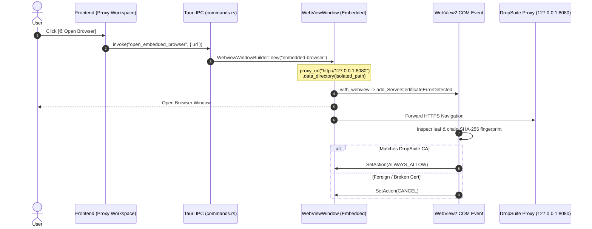

# DropSuite P3 — Embedded Browser Specification

## 1. Overview & Security Motivation

The **Embedded Browser** provides a zero-setup, one-click browsing experience directly connected to DropSuite's loopback proxy listener (`127.0.0.1:8080`), mirroring the workflow of Burp Suite Professional's "Open Browser".

### Core Security Guarantees
1. **Zero System Trust Contamination**: Sesuai prinsip DropSuite P2 (*"The app never installs trust anywhere"*), the embedded browser runs in an isolated context and never modifies the Windows Certificate Store (`certutil`, `LocalMachine\Root`, `CurrentUser\Root`).
2. **Honest Upstream Security Validation**: The browser **does NOT** use a blanket `--ignore-certificate-errors` flag. Instead, it hooks the WebView2 `ServerCertificateErrorDetected` event.
   - If the certificate chain terminates at DropSuite's local Root CA (allowlisted host decrypted & re-signed by DropSuite) -> `ALWAYS_ALLOW`.
   - If the certificate is NOT from DropSuite's Root CA (blind-tunneled host with an invalid/expired/untrusted remote certificate) -> `CANCEL` (Rejected). Upstream security posture remains truthfully reported to the tester.
3. **Storage & Profile Isolation**: Uses a dedicated data directory (`<DROPSUITE_DATA_DIR>/browser-profile/`) separate from the primary DropSuite IDE window, preventing cookie/cache collision and adhering to WebView2 requirements.

---

## 2. Technical Stack & Architecture

- **Tauri Version**: Tauri v2 (`tauri` 2.x, `tauri-build` 2.x).
- **Underlying Engine**: Microsoft Edge WebView2 on Windows (`tauri-runtime-wry`, `wry`, `webview2-com` 0.39.x).
- **Target OS**: Windows 10 / 11 (64-bit).

### Component Flow


---

## 3. Detailed Component Design

### 3.1 IPC Command (`crates/dropsuite-app/src/commands.rs`)

```rust
#[tauri::command]
pub async fn open_embedded_browser(
    app: tauri::AppHandle,
    state: tauri::State<'_, EngineState>,
    initial_url: Option<String>,
) -> Result<(), String> {
    // 1. Get proxy listener port from state
    let status = state.engine()?.proxy.lock().await.status();
    if !status.is_running {
        return Err("Proxy listener is not running. Please start the listener first.".into());
    }

    // 2. Resolve DropSuite Root CA SHA-256 fingerprint
    let ca_fp = state.engine()?.https_settings().fingerprint
        .ok_or_else(|| "Root CA has not been generated. Please generate a CA first.".to_string())?;

    // 3. Build WebviewWindow with isolated data directory and proxy URL
    let data_dir = engine::data_dir(&app)
        .map_err(|e| e.to_string())?
        .join("embedded-browser");

    let proxy_url = url::Url::parse(&format!("http://127.0.0.1:{}", status.port))
        .map_err(|e| e.to_string())?;

    let start_url = initial_url
        .as_deref()
        .unwrap_or("https://alytica.my.id/");

    platform::spawn_embedded_browser(&app, &proxy_url, &data_dir, start_url, &ca_fp)
        .map_err(|e| e.to_string())?;

    Ok(())
}
```

### 3.2 Platform Implementation (`crates/dropsuite-app/src/platform.rs`)

```rust
#[cfg(windows)]
pub fn spawn_embedded_browser(
    app: &tauri::AppHandle,
    proxy_url: &url::Url,
    data_dir: &std::path::Path,
    url: &str,
    expected_root_fp: &str,
) -> Result<tauri::WebviewWindow, String> {
    use tauri::WebviewUrl;
    use tauri::WebviewWindowBuilder;

    // Close any previous instance cleanly
    if let Some(existing) = app.get_webview_window("embedded-browser") {
        let _ = existing.close();
    }

    let parsed_url: url::Url = url.parse().map_err(|e| format!("Invalid URL: {e}"))?;

    let window = WebviewWindowBuilder::new(
        app,
        "embedded-browser",
        WebviewUrl::External(parsed_url),
    )
    .title("DropSuite Browser")
    .inner_size(1200.0, 800.0)
    .proxy_url(proxy_url.clone())
    .data_directory(data_dir.to_path_buf())
    .build()
    .map_err(|e| format!("Failed to create embedded browser window: {e}"))?;

    // Attach ServerCertificateErrorDetected hook via Windows platform webview
    hook_cert_error_handler(&window, expected_root_fp)?;

    Ok(window)
}
```

### 3.3 Certificate Verification Handler (`ServerCertificateErrorDetected`)

```rust
// Pseudocode / COM implementation skeleton
// Event handler checks Issuer Chain:
// 1. args.ServerCertificate() -> ICoreWebView2Certificate
// 2. inspect PemEncodedIssuerCertificateChain or SHA256 thumbprint
// 3. Compare with DropSuite active CA fingerprint
// 4. if match -> SetAction(COREWEBVIEW2_SERVER_CERTIFICATE_ERROR_ACTION_ALWAYS_ALLOW)
//    else -> SetAction(COREWEBVIEW2_SERVER_CERTIFICATE_ERROR_ACTION_CANCEL)
```

---

## 4. Frontend Integration

### UI Placement (`frontend/src/workspaces/ProxyWorkspace.tsx`)
In the top listener bar next to the `Start / Stop` control:
```tsx
<button
  className="btn"
  onClick={handleOpenBrowser}
  title="Open Pre-configured Embedded Browser (Isolated, Proxy & CA Auto-configured)"
  style={{
    display: 'flex',
    alignItems: 'center',
    gap: 6,
    background: 'var(--panel)',
    border: '1px solid var(--line)',
    color: 'var(--text)',
    padding: '4px 10px',
    borderRadius: 4,
    fontSize: 12,
  }}
>
  <Globe size={13} style={{ color: 'var(--accent)' }} />
  Open Browser
</button>
```

---

## 5. Implementation & Verification Checklist

- [ ] Declare `open_embedded_browser` in `crates/dropsuite-app/build.rs`.
- [ ] Add permission `allow-open-embedded-browser` in `crates/dropsuite-app/capabilities/main-window.json`.
- [ ] Register `commands::open_embedded_browser` in `crates/dropsuite-app/src/main.rs`.
- [ ] Verify isolated data directory creation (`DROPSUITE_DATA_DIR/embedded-browser`).
- [ ] Verify proxy forwarding on loopback listener (`127.0.0.1:8080`).
- [ ] Verify `ALWAYS_ALLOW` for allowlisted DropSuite-decrypted HTTPS hosts.
- [ ] Verify `CANCEL` for non-DropSuite invalid upstream certificates.
- [ ] Verify frozen release candidate artifacts in `target/release/` and `verify/` remain byte-identical.
