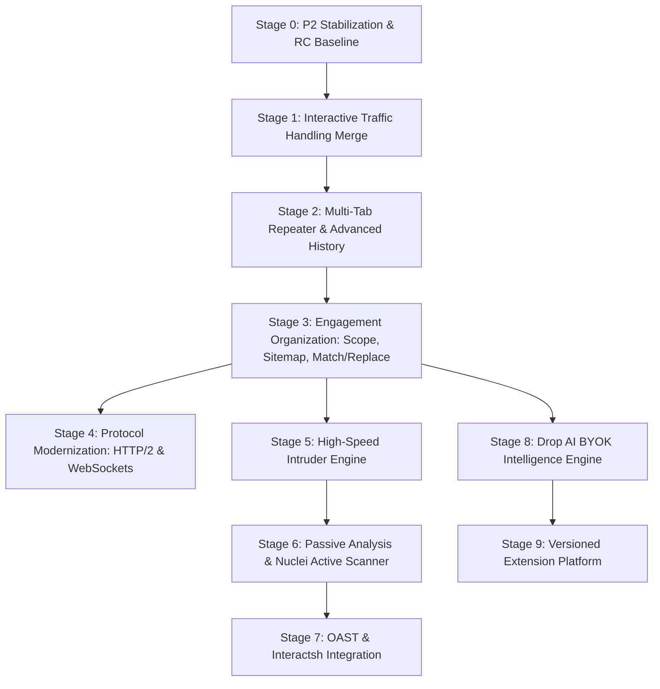

# DropSuite — Professional Parity Roadmap & Architecture Assessment

**Author:** Lead Software Architect & Senior Application-Security Engineer  
**Document Status:** Bounded Assessment & Strategic Specification (Pass 1)  
**Date:** 2026-10-20  
**Baseline Verification:** DropSuite P2 RC1 (`rea_software`) & Interactive Proxy Prototype (`dropsuite-p2next`)  

---

## 1. Executive Summary & Baseline Context

DropSuite is an open-source, local-first web application security testing platform built in **Rust (Tokio), SQLite (WAL), and Tauri/React**. Its architectural mission is to provide professional-grade security testing capabilities (historically monopolized by proprietary, commercial tools such as Burp Suite Professional) under a clean-room, unthrottled, privacy-first, and zero-telemetry operational model.

This document establishes an **evidence-based, code-grounded capability assessment** and an **ordered engineering roadmap** toward professional functional parity. 

### Core Architectural Invariants:
1. **Clean-Room Engineering:** All protocols, parsers, and interfaces adhere strictly to open RFC standards (RFC 9110, RFC 9112, RFC 8446). No decompiled code, reverse-engineered bytecode, or proprietary assets from PortSwigger / Burp Suite are used.
2. **Local-First & Zero Egress:** Traffic, session state, and history reside entirely in a local embedded SQLite database (`dropsuite.db`). Outbound connections occur strictly when initiated or configured by the operator.
3. **Defense-in-Depth Destination Policy:** A centralized destination filter (`is_restricted_destination`) validates all resolved IP addresses at the socket boundary across all tools (Proxy, Replay, Intruder, Scanner) to prevent localhost loopback loops, cloud metadata exfiltration (AWS IMDSv1/v2, Alibaba), and SMTP relay abuse.
4. **Data Sanitization at Storage Boundaries:** Sensitive credentials (tokens, session cookies, passwords) are automatically redacted before disk persistence, while wire representations remain intact in memory during active inspection.

---

## 2. Evidence-Based Feature & Capability Gap Matrix

Every capability evaluated below is assigned exactly one status:
- **VERIFIED:** Implementation and corresponding test evidence both exist in repository source code.
- **PARTIAL:** Real functional implementation exists, but essential professional workflow requirements remain missing.
- **MISSING:** No meaningful implementation exists in the current codebase.
- **UNKNOWN:** Insufficient evidence to verify.

| # | Feature / Capability Area | Status | Primary Source Files | Verification Evidence & Tests | Gaps & Missing Functionality |
|---|---|---|---|---|---|
| 1 | **HTTP Proxy & HTTPS Interception** | **VERIFIED** | `crates/dropsuite-core/src/proxy.rs` `crates/dropsuite-core/src/https.rs` `crates/dropsuite-core/src/ca.rs` `crates/dropsuite-core/src/allowlist.rs` | 18 streaming tests (`http_streaming_test.rs`) 24 TLS tests (`https_interception_test.rs`) 15 policy tests (`destination_policy_test.rs`) 33 CDP checks (`accept.mjs`) | Loopback IPv4 default (`127.0.0.1`); bare IPv6 bind UI unexposed; non-allowlisted CONNECT acts as blind tunnel. |
| 2 | **Interactive Interception (Hold / Drop / Edit / Forward)** | **VERIFIED** *(in `p2next`)* / **MISSING** *(in `rea_software`)* | `crates/dropsuite-core/src/interception.rs` `crates/dropsuite-core/src/proxy.rs` `crates/dropsuite-app/src/commands.rs` `frontend/src/components/InterceptPanel.tsx` | 21 regression tests in `interactive_proxy_test.rs` (all passed): - 6 forward tests (GET, POST body, batch, toggle-off) - 3 drop tests (request drop, response drop, batch) - 4 edit tests (path, headers+JSON body, invalid 400, response 418) - 3 cancel tests (eviction, client disconnect, noop) - 2 timeout tests (504 request, response auto-forward) - 3 capacity tests (503 backpressure, queue recovery, 413 size) | Implemented and verified in isolated workspace `dropsuite-p2next`; pending formal merge into main release baseline. E2E browser automation (CDP test) pending. |
| 3 | **HTTP History Search & Analysis** | **PARTIAL** | `crates/dropsuite-core/src/storage.rs` `crates/dropsuite-core/src/models.rs` `crates/dropsuite-core/src/sanitize.rs` `frontend/src/workspaces/ProxyWorkspace.tsx` | `storage_test.rs` (SQLite CRUD) `redaction_e2e_test.rs` `text_and_header_secrets_e2e_test.rs` `escaped_secrets_e2e_test.rs` | Only basic substring search, HTTP method filter, and high-level status (2xx/3xx/4xx/5xx) exist. Missing: regex body search, MIME/content-type filters, column sorting, response length range, multi-parameter boolean logic, HAR/CSV export. |
| 4 | **Multi-Tab Repeater** | **PARTIAL** | `crates/dropsuite-core/src/replay.rs` `crates/dropsuite-app/src/commands.rs` `frontend/src/workspaces/ReplayWorkspace.tsx` | 9 unit/integration tests in `replay_test.rs` 10 UI checks in `replay_blocked.mjs` | Core `replay::send_with` engine is verified, but UI supports only a **single draft request**. Missing: multi-tab manager, named tabs, tab color tagging, request history per tab, visual side-by-side response diffing, automatic `Content-Length` recalculation toggle. |
| 5 | **HTTP/2 & WebSocket Support** | **MISSING** | `crates/dropsuite-core/src/proxy.rs` (lines 427 & 1512) | `http_streaming_test.rs::upgrade_keeps_its_headers...` | HTTP/2 connection preface (`PRI * HTTP/2.0...`) explicitly returns `505 HTTP Version Not Supported`. WebSockets pass as opaque TCP streams (`relay_tunnel`) without frame decoding, inspection, tampering, or history recording. |
| 6 | **Target Scope & Hierarchical Sitemap** | **MISSING** | None | No test files | No scope inclusion/exclusion regex engine exists. No host/path hierarchical tree visualization exists. No target scope filtering across Proxy, Replay, or Storage exists. |
| 7 | **Intruder / High-Speed Fuzzing Engine** | **MISSING** | None | No test files | No payload position parser (`§param§`), no attack strategies (Sniper, Battering Ram, Pitchfork, Cluster Bomb), no wordlist generators, no concurrency pool, and no response grep extraction. |
| 8 | **Passive Vulnerability Analysis** | **DONE (basic)** | `frontend/src/lib/findings.ts` | `findings.test.ts` | No background rules inspecting headers, cookie security attributes (`HttpOnly`, `Secure`, `SameSite`), CORS misconfigurations, or cleartext sensitive data exposures. |
| 9 | **Active Scanner & Nuclei Integration** | **DONE (native, 4 checks)** | `crates/dropsuite-core/src/active_scan.rs` | `active_scan_test.rs` | Native checks first: reflected XSS, SQL error, path traversal, open redirect, with evidence and confidence. Nuclei integration and OOB remain open. | No crawler, active fuzzing audit dispatcher, or subprocess integration with ProjectDiscovery's Nuclei template engine. |
| 10 | **OAST (Out-of-Band AST) & Interactsh** | **MISSING** | None | No test files | No out-of-band correlation client, interaction listener, or integration with Interactsh for Blind SSRF, Blind XSS, or DNS exfiltration testing. |
| 11 | **Drop AI (BYOK Multi-Provider Engine)** | **MISSING** | None | No test files | No LLM provider bridge (OpenAI format, Anthropic format, Ollama local), no credential redaction pre-flight filter, no DPAPI secret storage for API keys, and no security prompt workflows. |
| 12 | **Match & Replace and Session Rules** | **MISSING** | None | No test files | No runtime request/response regex transformation rules; no automated session token refresh macros. |
| 13 | **Extension API & Plugin Isolation** | **MISSING** | None | No test files | No extensibility layer (WASM host, Python bridge, or IPC sidecar API) for third-party extensions. |
| 14 | **Project Persistence & Engagement Management** | **PARTIAL** | `crates/dropsuite-core/src/storage.rs` `crates/dropsuite-core/src/models.rs` | `storage_test.rs` | Single local database (`dropsuite.db`) persists across daemon restarts. Missing: project switching (`.dropsuite` project bundles), engagement metadata, target notes, export/import archive format. |

---

## 3. Comprehensive Architecture Assessment

### 3.1. Reusable Verified Foundations
The existing DropSuite code contains rock-solid, production-grade components that should be preserved and reused directly:
1. **Asynchronous I/O Pipeline (`dropsuite-core/src/http1.rs`):**
   - High-throughput streaming body copier (`copy_body`) with chunked framing, length framing, and until-close handling.
   - Zero-allocation head inspection via `httparse`.
   - Streaming `Capture` buffer with strict `CAPTURE_LIMIT` (1 MB) to prevent out-of-memory denial of service.
2. **Centralized Destination Policy (`dropsuite-core/src/proxy.rs`):**
   - Single unified function `is_restricted_destination(SocketAddr)` applied across HTTP, CONNECT, intercepted TLS sessions, and Replay.
   - Refuses link-local addresses, multicast, loopback self-connections (`508 Loop Detected`), SMTP port 25, and cloud metadata endpoints (`169.254.169.254`, `100.100.100.200`, `fd00:ec2::254`).
   - One-shot DNS resolution with strict IP pinning prevents Time-of-Check to Time-of-Use (TOCTOU) rebinding attacks.
3. **DPAPI-Protected Dynamic CA (`dropsuite-core/src/ca.rs`):**
   - Dynamic leaf certificate generation using `rcgen` and `rustls`.
   - Private root CA keys stored encrypted with Windows Data Protection API (DPAPI, `CurrentUser` scope).
   - Zero installation into Windows or browser root certificate stores (air-gapped manual operator export only).
4. **Storage & Boundary Sanitization (`dropsuite-core/src/storage.rs`, `sanitize.rs`):**
   - Embedded SQLite in WAL mode with robust concurrent reader/writer handling.
   - Comprehensive regex and AST sanitization (`sanitize_record`) masking secrets (passwords, bearer tokens, API keys) at the persistence boundary.

### 3.2. Real Architectural Gaps & Required Interface Evolution
1. **Replay Interface Evolution:**
   - Currently `crates/dropsuite-core/src/replay.rs` operates on a stateless `(RequestSnapshot, ReplayOptions)` tuple.
   - *Evolution needed:* Must support stateful tab sessions, persistent tab metadata, and cancellation tokens (`tokio_util::sync::CancellationToken`) so long-running requests can be aborted cleanly.
2. **Backend Scope Trait:**
   - Currently no component knows about "Target Scope".
   - *Evolution needed:* Introduce `ScopeManager` in `dropsuite-core` exposing `is_in_scope(&Url) -> bool`. This must be consumed by `ProxyEngine` (to tag or filter traffic), `StorageManager` (to index), and future `Intruder` and `Scanner` engines.
3. **Subprocess & Worker Orchestration:**
   - Currently the app is monolithic inside Tauri.
   - *Evolution needed:* High-throughput Intruder attacks and external scanners (Nuclei, Interactsh) require an isolated worker architecture with bounded thread pools, backpressure channels, and dedicated pause/resume controls.

---

## 4. Ordered Milestone Implementation Plan

The roadmap is structured in 10 sequential, dependency-ordered stages. Each stage builds strictly on verified capabilities from prior stages.

### Stage 0: Stabilize P2 Release Baseline
- **Goal:** Conclude P2 RC1 verification, archive signed/hashed artifacts, and maintain frozen baseline in `rea_software`.
- **Pre-conditions:** All 125 workspace tests passing; 33/33 `accept.mjs` checks passing.
- **Rules:** Zero edits to P2 release artifacts; separate branch/working directory for future milestone work.

### Stage 1: Complete Interactive Traffic Handling (Phase 1 Merge)
- **Goal:** Formally integrate the verified Phase 1 Interactive Proxy from `dropsuite-p2next` into the primary development line.
- **Core Elements:**
  - `InterceptManager` in `dropsuite-core`: bounded queue (max 100), configurable timeout, body limit (1 MB).
  - Clean drop semantics (connection dropped without 502).
  - Malformed edited wire rejection (`400 Bad Request`).
  - Response interception with auto-forward on timeout.
  - IPC commands in `dropsuite-app` and HTTP daemon bridge in `dropsuite-desktop`.
- **Exit Criteria:** All 21 `interactive_proxy_test` tests passing; frontend Intercept tab functioning with keyboard shortcuts (`Ctrl+F`, `Ctrl+D`).

### Stage 2: Multi-Tab Repeater & Advanced Traffic Analysis
- **Goal:** Transform single-draft Replay into a professional multi-tab workbench, and upgrade History analysis.
- **Core Elements:**
  - Backend: Persistent Repeater tab store in SQLite (`repeater_tabs` table: `id`, `name`, `color`, `request_raw`, `history_records`).
  - Frontend: Tab bar with add, close, rename, duplicate, color tags; side-by-side or stacked request/response inspector; visual diff view comparing baseline vs current response.
  - History Upgrade: Column sorting (time, status, method, size, latency); regex search across headers/body; content-type/MIME filtering; export selection to `.har` and Markdown.
- **Exit Criteria:** 10+ concurrent Repeater tabs retain independent state across app restarts; diffing correctly highlights header/body changes.

### Stage 3: Engagement Organization (Target Scope, Sitemap, Match & Replace)
- **Goal:** Provide structured target boundary control and automated traffic manipulation.
- **Core Elements:**
  - Scope Engine (`dropsuite-core/src/scope.rs`): Include/Exclude rules (protocol, host regex, port, path prefix). Enforced in backend before storage or active testing.
  - Hierarchical Sitemap (`dropsuite-core/src/sitemap.rs`): Tree structure aggregating endpoints, parameters, observed status codes, and HTTP methods.
  - Match & Replace (`dropsuite-core/src/match_replace.rs`): Regex replacement rules applied in-flight to request headers, request bodies, response headers, or response bodies.
- **Exit Criteria:** Proxy correctly tags or filters out-of-scope traffic; Sitemap accurately renders tree hierarchy from proxy traffic.

### Stage 4: Protocol Modernization (HTTP/2 Multiplexing & WebSocket Inspection)
- **Goal:** Native protocol support reflecting modern web applications.
- **Core Elements:**
  - HTTP/2: Replace 505 rejection with genuine H2 framing (`h2` crate). Support client-to-proxy and proxy-to-origin multiplexing with stream isolation and flow control.
  - WebSockets: Decode framing (RFC 6455) for intercepted TLS/HTTP connections. Record discrete WebSocket text/binary messages in a dedicated sub-table. Support live message tampering.
- **Exit Criteria:** Intercepts, decrypts, and displays H2 multiplexed requests and WebSocket messages without connection stalling.

### Stage 5: High-Speed Intruder Engine
- **Goal:** Unthrottled, customizable fuzzing and parameter automation.
- **Core Elements:**
  - Attack Models: Sniper, Battering Ram, Pitchfork, Cluster Bomb.
  - Position Markers: Configurable delimiters (default `§payload§`).
  - Generators: Wordlist file reader, numeric sequences, brute-force combinators, custom regex expansions.
  - Execution Pool: Bounded Tokio worker pool with operator-controlled concurrency (1 to 500 reqs/sec), rate-limiting (`governor` crate), and instant cancellation.
  - Result Analyzer: Status code distribution, byte length delta, response latency, Grep Match (regex pattern matching), Grep Extract (token extraction).
- **Exit Criteria:** Intruder runs 10,000 requests against loopback fixture with 0 dropped frames, precise rate control, and instant cancellation.

### Stage 6: Passive Security Audit & Nuclei Active Scanner Integration
- **Goal:** Continuous vulnerability assessment combining passive heuristic rules with community-driven active templates.
- **Core Elements:**
  - Passive Auditor: Zero-traffic inspection engine evaluating observed transactions against safe rules (missing HSTS, CSP misconfigurations, `X-Content-Type-Options`, cookie flag omissions, sensitive tokens in query params).
  - Active Scanner via Nuclei: Subprocess orchestration invoking the local `nuclei` binary with strict target authorization (In-Scope only), versioned community templates, rate-limiting, and structured JSON results ingested into DropSuite's finding table.
- **Exit Criteria:** Passive rules raise zero false positives on standard traffic; Nuclei executes against local test target with results rendered directly in DropSuite Findings UI.

### Stage 7: OAST (Out-of-Band Application Security Testing) & Interactsh
- **Goal:** Detection of blind vulnerabilities (Blind SSRF, Blind XSS, Out-of-band SQLi/RCE).
- **Core Elements:**
  - Client Integration: Asynchronous client library for ProjectDiscovery's Interactsh server (supporting public `oast.pro` or self-hosted private servers).
  - Payload Injector: Unique session token generation (`<id>.oast.site`).
  - Correlation Poller: Periodic background polling over encrypted channels; correlates incoming DNS, HTTP, and SMTP interactions back to the originating Intruder/Repeater request.
- **Exit Criteria:** Simulated blind interaction triggers alert in DropSuite within 3 seconds of DNS query.

### Stage 8: Drop AI (BYOK Security Intelligence Engine)
- **Goal:** AI-assisted security analysis without vendor lock-in, recurring subscriptions, or privacy compromises.
- **Core Elements:**
  - Provider Abstraction (`AiProvider` trait):
    - OpenAI-Compatible (`/v1/chat/completions`): OpenAI, Ollama (local offline), vLLM, DeepSeek, Groq, OpenRouter.
    - Anthropic-Compatible (`/v1/messages`): Claude 3.5 Sonnet / Haiku.
  - Secret Protection: API keys encrypted at rest using Windows DPAPI (`CurrentUser` scope) or secure OS keychain. Keys never touch frontend source or unencrypted logs.
  - Sanitization Gate: Pre-egress redaction filter replacing session cookies, bearer tokens, and configured secrets with `[REDACTED_BY_DROPSUITE]` before sending context to external models.
  - Confirmation Dialog: UI explicitly displays exact raw prompt text and token count to the operator before transmission.
  - Security Workflows: Contextual anomaly explanation, bypass payload suggestions, Python PoC script generation, and structured vulnerability report drafting.
- **Exit Criteria:** Local Ollama model executes audit on mock request with 100% data remaining on loopback; cloud provider receives fully sanitized prompt only after user confirmation.

### Stage 9: Versioned Extension Platform
- **Goal:** Safe community extensibility without risking core stability.
- **Core Elements:**
  - Extension Runtime: WebAssembly (WASM via `wasmtime`) or lightweight JSON-RPC over stdio sidecars.
  - Capabilities: Register custom payload generators, custom passive checks, HTTP message transformers, and UI tabs.
  - Sandboxing: Extensions run out-of-process with explicit permission manifests (e.g., `network:outbound`, `storage:read`).
- **Exit Criteria:** Example WASM extension registers custom Intruder payload generator and modifies in-flight requests.

---

## 5. Prioritized First Implementation Milestone

### Milestone: Stage 1 — Formal Merge & Hardening of Interactive Proxy

To establish a solid operational foundation before building Multi-Tab Repeater or Intruder, we must finalize the Interactive Proxy module.

#### Modules & Files Involved:
- `crates/dropsuite-core/src/interception.rs` (Core state machine & hold queues)
- `crates/dropsuite-core/src/proxy.rs` (Request/response pipeline integration)
- `crates/dropsuite-app/src/commands.rs` (Tauri IPC endpoints)
- `crates/dropsuite-app/capabilities/main-window.json` (ACL permissions)
- `crates/dropsuite-desktop/src/main.rs` (Daemon HTTP bridge endpoints)
- `frontend/src/components/InterceptPanel.tsx` (User interface & hotkeys)
- `crates/dropsuite-core/tests/interactive_proxy_test.rs` (Regression test suite)

#### Specific Acceptance Criteria:
1. `ProxyEngine` with `intercept.set_enabled(true)` holds matching in-flight requests in memory.
2. Queue capacity enforces strict backpressure: requests beyond 100 items receive `503 Service Unavailable` with zero memory leaks.
3. User editing wire format preserves valid HTTP/1.1 framing while recomputing `Content-Length`. Malformed edited text returns `400 Bad Request` to client and never contacts origin.
4. User dropping request immediately terminates client socket without transmitting data upstream.
5. Inactive held requests time out deterministically (default 60s, configurable in tests) returning `504 Gateway Timeout`.
6. Client disconnecting while held automatically evicts the held message.
7. Workspace tests pass 100% (146 passed, 0 failed).

---

## 6. Comprehensive Risk Register

| Risk Category | Identified Hazard | Severity | Mitigation Strategy |
|---|---|---|---|
| **Security** | SSRF or cloud metadata access via Scanner/Intruder automation | **CRITICAL** | Mandate that all active tools route traffic exclusively through the verified destination policy (`is_restricted_destination`). Deny 169.254.0.0/16, metadata IPs, and loopback aliases at the resolved IP stage. |
| **Security** | Plaintext API key exposure in Drop AI settings | **HIGH** | Encrypt API keys using Windows DPAPI (`CryptProtectData`). Never include API keys in frontend logs, diagnostic files, or crash dumps. |
| **Privacy** | Sensitive customer session tokens transmitted to cloud AI providers | **HIGH** | Implement automated pre-flight redaction gate. Enforce local-first rule by default (Ollama recommendation). Require explicit user confirmation showing exact prompt before egress. |
| **Performance** | Memory exhaustion from massive Intruder attacks or giant HTTP History | **HIGH** | Bounded queues for all channels. Virtualized table rendering in frontend. Disk-backed SQLite storage for transaction bodies rather than unbounded in-memory heaps. |
| **Compatibility** | Upstream server TLS fingerprinting or HTTP/2 protocol anomalies | **MEDIUM** | Strict adherence to RFC 9110/9112 and standard ALPN negotiation. Allow per-target TLS configuration options. |
| **Maintenance** | Rapid churn of Nuclei templates or external tool APIs | **MEDIUM** | Decouple scanning logic from template definitions. Use versioned, tagged Nuclei releases and standard JSON output interfaces. |

---

## 7. Verification & Acceptance Framework

Every milestone requires a 3-tier verification gate before acceptance:
1. **Unit & Property Tests:** Pure Rust unit tests for state machines, parsers, and data transformers (`cargo test -p <crate> --lib`).
2. **Integration & Fault Tests:** Mock-server-backed network tests covering successful paths, edge cases, malformed payloads, rate limits, timeouts, and unexpected connection resets (`cargo test --test <suite>`).
3. **End-to-End Functional / CDP Verification:** Headless browser automation driving the real frontend, interacting with live UI controls, and asserting byte-exact behavior against loopback fixtures. Zero interaction with real cloud services or external targets during automated tests.
